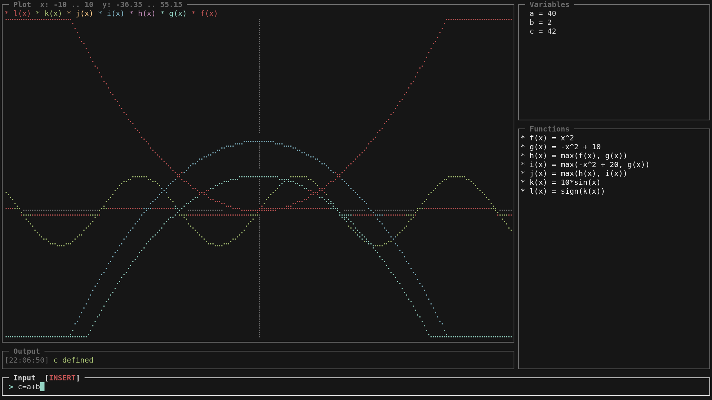
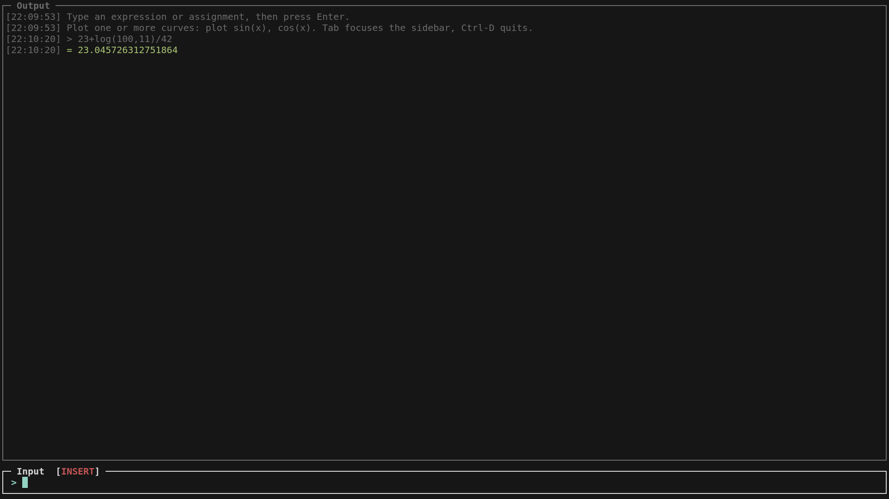
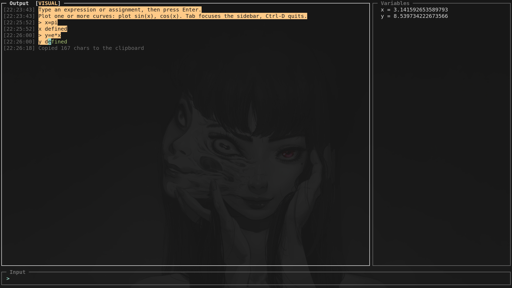

# Calculus

A terminal-based calculator for symbolic calculus, mathematical expressions, and function plotting.

Calculus is a command-line mathematics tool written in Rust. It combines numerical expression evaluation, symbolic algebra, differentiation, integration, user-defined functions, and terminal-based function plotting in a single application.

The application provides an interactive terminal interface as well as a line-oriented mode suitable for pipes and scripted input. Variables and functions can be defined using mathematical notation, expressions can be simplified symbolically, and derivatives and antiderivatives can be generated directly from the command line.

---







---

## Table of Contents

- [Features](#features)
- [Getting Started](#getting-started)
- [Usage](#usage)
- [Mathematical Expressions](#mathematical-expressions)
- [Built-in Functions](#built-in-functions)
- [Symbolic Calculus](#symbolic-calculus)
- [Function Plotting](#function-plotting)
- [Session Persistence](#session-persistence)
- [Architecture](#architecture)
- [Development](#development)
- [Limitations](#limitations)
- [Contributing](#contributing)
- [License](#license)

---

## Features

### Mathematical Evaluation
* Evaluate arithmetic and mathematical expressions.
* Support for addition, subtraction, multiplication, division, exponentiation, and unary signs.
* Exact rational arithmetic for constant expressions, such as `1/3` and `0.1 + 0.2` (evaluated as `1/3` and `3/10`).
* Implicit multiplication, such as `2x` and `3(x + 1)`.
* Mathematical constants `pi`, `PI`, `π`, and `e`.
* Variables with dependency-aware recalculation.
* User-defined functions with one or more parameters.
* Recursive user-defined functions, subject to a call-depth limit.

### Symbolic Mathematics
* Algebraic expression simplification.
* Symbolic differentiation with respect to `x`.
* Symbolic antiderivative generation where supported, optionally with respect to a chosen variable.
* Symbolic linear equation solving, plus quadratic solving with exact or symbolic roots.
* Definite integration using symbolic antiderivatives when available.
* Numerical definite integration using composite Simpson's rule when no supported symbolic antiderivative is found.
* Symbolic inverse transformations for supported function expressions.
* Finite sums and products (`sum`, `prod`, `∑`, `∏`) over an integer range.

### Terminal Interface
* Interactive terminal application.
* Line-oriented execution for non-interactive input.
* Text-based function plotting using Unicode Braille characters.
* Persistent session state for definitions, plots, settings, and input history in interactive mode.
* Commands for managing variables, functions, plots, and history.

---

## Getting Started

### Prerequisites

Calculus is implemented in Rust and uses the **Rust 2024 edition**.

You need:
* A Rust toolchain with **Cargo**.
* A terminal that supports standard text input and output.
* A Unicode-capable terminal for the intended appearance of plotted graphs.

Install Rust through `rustup` if it is not already available.

Verify your installation:
```bash
rustc --version
cargo --version

```

### Installation

1. Clone the repository and enter the project directory:
```bash
git clone https://github.com/floppyist/calculus.git
cd calculus

```


2. Build the application:
```bash
cargo build --release

```


3. Start Calculus:
```bash
cargo run --release

```


Alternatively, execute the compiled binary directly:
```bash
./target/release/calculus

```


*(On Windows, the compiled executable is located at `target\release\calculus.exe`.)*

---

## Usage

Calculus automatically selects its execution mode based on whether standard input and standard output are attached to terminals.

* **Interactive mode:** Starts the terminal application when both standard input and standard output are terminals.
* **Line-oriented mode:** Processes input line by line when either stream is redirected or piped.

### Line-Oriented (Pipe) Mode

When either standard input or standard output is not a terminal, Calculus skips the fullscreen interface and reads input line by line. It prints a `> ` prompt, evaluates each line as an expression, an assignment, or a command, and exits at end of input (EOF).

```bash
echo "2 + 3 * 4" | ./target/release/calculus
# > = 14
# Variables: (none)
# Functions: (none)

printf 'a = 3\nb = a + 1\nb\n' | ./target/release/calculus

```

The environment is shared for the whole run, so definitions on earlier lines are visible to later lines of the same stream. After every evaluated expression the current variables and functions are written as two status lines:

```text
> a = 3
Variables: a = 3
Functions: (none)
> b = a + 1
Variables: a = 3, b = 4
Functions: (none)
```

Behavior differences from interactive mode:

* Commands that only affect the interactive display (`clear`, `clear info`, `clear plots`, `clear eq`, `clear history`, `history`, `show`, `hide`, `scales`) have no visible effect.
* `clear vars`, `clear funcs`, and `clear all` still mutate the shared environment and confirm in the output.
* `?` prints `Help is only available in interactive mode`.
* `plot` renders a colorless Braille plot sized from the `COLUMNS` and `LINES` environment variables (default `80` by `24`).
* Session state is neither loaded nor saved, so every run starts with an empty environment.
* Blank lines are ignored, and `quit` / `exit` stop the stream before EOF.

### Evaluating Expressions

Enter a mathematical expression to evaluate it:

```text
> 2 + 3 * 4
= 14

```

Additional examples:

```text
> sqrt(81)
= 9

> sin(pi / 2)
= 1

> 2^10
= 1024

```

*(The examples illustrate the intended expression syntax; displayed numeric formatting may vary.)*

### Defining Variables

Assign expressions to variables using `=`:

```text
> a = 10
> b = 5
> c = a + b

```

Evaluate a variable or an expression that references it:

```text
> c
= 15

> a * b
= 50

```

Variables can depend on other variables. When a definition changes, dependent values are recalculated according to their dependency order.

For example:

```text
> a = 4
> b = a * 3
> a = 7
> b
= 21

```

*(Circular variable dependencies are rejected.)*

The Variables pane also lists the built-in constants: `pi`, `e`, and the integration constant letters currently used by stored functions. They are shown with a `[const]` tag; a constant you assign becomes a normal variable and is shown as `[custom]`:

```text
> e = 2
> e
= 2

```

The two-letter constant `pi` cannot be redefined (this is a documented limitation of the single-letter variable store), while `e` can.

### Defining Functions

Define a function by writing its name, parameter list, and expression:

```text
> f(x) = x^2 + 2x + 1

```

Functions can be evaluated by calling them:

```text
> f(3)
= 16

> f(5)
= 36

```

Multiple parameters are supported:

```text
> g(x, y) = x^2 + y^2
> g(3, 4)
= 25

```

*(Function parameters are evaluated in a local context and take precedence over global variables with the same names.)*

### Simplifying Expressions

Use `simplify` or its alias `simp`:

```text
> simplify 2x + 3x
= 5x

> simp (x + 1)^2

```

The simplifier applies algebraic rewrite rules to produce a more compact symbolic expression. The exact result depends on the supported transformation rules.

### Differentiation

Use `diff`, `derive`, or `derivative` followed by an expression:

```text
> diff x^3

```

Calculus symbolically differentiates the expression with respect to $x$ and stores the result as a newly named function.

For a supported polynomial, the result is mathematically equivalent to:


$$f(x) = 3x^2$$

The generated function name is selected automatically based on the names already in use.

### Integration

Use `integrate`, `integral`, or `int` for integration.

* **Indefinite integration:**
```text
> integrate x^2

```


When a symbolic antiderivative is available, Calculus creates a new function representing it and appends its own integration constant, drawn from the letters `C D F G H J K L M N P Q R S T U V W X Y Z` (one letter per antiderivative). The constant defaults to zero and can be set like any variable, which recomputes every function that uses it. For example:

$$\int x^2 \, dx = \frac{x^3}{3} + C$$

```text
> int x^2
f(x) = 1/3*x^3 + C

> int x^3
g(x) = 1/4*x^4 + D

> C = 5
> f(0)
= 5
```


* **Integration with respect to another variable:**

```text
> int x*y, y
f(y) = 1/2*xy^2 + C
```


The second argument selects the integration variable; the remaining variables are treated as constants.


* **Definite integration:**
```text
> integrate x^2, 0, 3

```


The three arguments represent the integrand, lower bound, and upper bound.
For the example above:

$$\int_{0}^{3} x^2 \, dx = 9$$


Symbolic integration covers polynomials (including negative powers such as `1/x^2`), linear inner functions, the elementary functions, and the substitution rule $f'(x)\,g(f(x))$ — including natural-exponential factors such as `int 2x*e^(x^2)` and the identity case $\int F\,F' = F^2/2$ (for instance `int sin(x)*cos(x)`). Reciprocal patterns are recognized as well: $f'/f \to \ln|f|$ (`int 2x/(x^2+1)`), $1/(a+bx^2) \to \frac{1}{\sqrt{ab}}\arctan(x\sqrt{b/a})$ (`int 1/(x^2+1)`), and the exponential fraction $1/(c_0+c_1e^{kx})$ (`int 1/(e^(3x)+1)`). Integration by parts chooses $u$ by the LIATE order, so `int x*ln(x)` integrates the logarithm first (as opposed to a purely polynomial driver, `int (2x+1)*e^(2x)`). If no supported antiderivative is found, definite integration uses composite Simpson's rule with 1,000 subintervals. Numerical results are approximations when numerical integration is used.

### Solving Equations

Use `solve` followed by an equation and the variable to solve for:

```text
> solve 3x = 2a + 2x + 3, x
x = 2a + 3

> solve x^2 - 1 = 0, x
x = 1
x = -1

```

Linear equations with symbolic coefficients and quadratic equations with numeric coefficients are supported. Quadratic roots are reported exactly when possible (as fractions) and otherwise in a symbolic square-root form; unsupported degrees return an error. Function calls on either side are expanded to their bodies before solving, so `solve f(x) = g(x), x` works when `f` and `g` are defined.

### Sums and Products

Use `sum` and `prod` to reduce an expression over an integer range. The first argument is the index variable, the next two are the lower and upper bound, and the last is the term:

```text
> sum(k, 1, 5, k)
= 15

> prod(k, 1, 5, k)
= 120

> sum(k, 1, 10, k^2)
= 385

```

The Unicode symbols `∑` and `∏` are accepted as aliases: `∑(k, 1, 4, k)` is the same as `sum(k, 1, 4, k)`. The index is bound locally, so it does not leak into the environment, and the bounds are evaluated as `ceil`/`floor` pairs; an empty range yields `0` for `sum` and `1` for `prod`. Bounds and the term may reference ordinary variables, so `n = 4` then `sum(k, 1, n, k)` gives `10` and recomputes when `n` changes.

### Printing Definitions

Use `print` to re-display a function, variable, or expression, which is convenient for long definitions:

```text
> print f(x)
f(x) = 3x^3 + 2x

```

### Showing and Hiding Panes

In interactive mode, individual panes can be toggled:

```text
> hide vars
> show funcs
> show all

```

Supported pane names are `plot`, `vars`, `funcs`, `eq`, `info`, and `all`. The `info` target toggles the status and echo lines; hiding it folds each result's input into its result line (for example `2+3*4 = 14`).

Definitions are content rather than status, so they stay in the output while `info` is hidden. The output then reads like a notebook that records every assignment and function definition next to the values it produced:

```text
f(x) = x^2
x = 4
f(x) = 16
2x+1 = 9

```

`clear info` follows the same rule: it drops the info and echo lines but keeps results and definitions.

### Command Reference

The following commands are recognized by the command parser:

| Command | Description |
| --- | --- |
| `?` | Request help in interactive mode |
| `quit` or `exit` | Exit the application |
| `plot <expression>` | Plot one or more expressions |
| `scales`, `scales on`, `scales off` | Control axis labels |
| `show <pane>` / `hide <pane>` | Toggle panes: `plot`, `vars`, `funcs`, `eq`, `info`, `all` |
| `clear` | Clear the output area in interactive mode (kept restorable with `history`) |
| `clear info` | Remove info and echo lines from the output |
| `clear vars` | Remove all variable definitions |
| `clear funcs` | Remove all user-defined functions |
| `clear eq` | Remove all solved equations |
| `clear plots` | Remove plotted curves in interactive mode |
| `history` | Restore the output most recently removed by `clear` |
| `clear all` | Clear variables, functions, equations, plots, history and the state file |
| `clear history` | Wipe the output and forget its restorable copy and the input history |
| `simplify` or `simp <expression>` | Simplify an expression |
| `diff`, `derive`, `derivative <expression>` | Differentiate an expression |
| `int`, `integral`, `integrate <expression>` | Compute an indefinite integral |
| `int <expression>, <var>` | Integrate with respect to a chosen variable |
| `int <expression>, <a>, <b>` | Compute a definite integral |
| `solve <equation>, <variable>` | Solve an equation for a variable |
| `print <name or expression>` | Print a function, variable, or expression |

*(Mode-specific behavior: Some commands are implemented differently in line-oriented mode. Help is only available in interactive mode, while commands that manipulate the interactive display, plots, history, or scales may have no visible effect in line-oriented mode.)*

---

## Mathematical Expressions

### Operators

| Operator | Operation | Example |
| --- | --- | --- |
| `+` | Addition | `2 + 3` |
| `-` | Subtraction and unary negation | `5 - 2`, `-x` |
| `*` | Multiplication | `3 * x` |
| `/` | Division | `x / 2` |
| `^` | Exponentiation | `x^2` |
| `()` | Grouping | `(x + 1)^2` |

Implicit multiplication is also supported:

* `2x`
* `3(x + 1)`
* `x sin(x)`

*(For readability and predictable parsing, explicit multiplication with `*` is recommended when expressions become complex.)*

### Constants

| Constant | Meaning |
| --- | --- |
| `pi` | Mathematical constant $\pi$ |
| `PI` | Alternative notation for $\pi$ |
| `π` | Alternative notation for $\pi$ |
| `e` | Euler's number (can be shadowed by assigning to `e`) |

### Precedence

Expressions follow conventional arithmetic precedence:

1. Parenthesized expressions.
2. Exponentiation.
3. Unary signs.
4. Multiplication and division.
5. Addition and subtraction.

Exponentiation is right-associative. For example, `2^3^2` is parsed as $2^{(3^2)}$.

Unary negation binds less tightly than exponentiation, so `-2^2` means $-(2^2)$, not $(-2)^2$.

---

## Built-in Functions

Calculus includes built-in mathematical functions for numerical evaluation (recognized case-insensitively by the tokenizer).

### Roots and Absolute Value

| Function | Description |
| --- | --- |
| `sqrt(x)` | Square root |
| `cbrt(x)` | Cube root |
| `abs(x)` | Absolute value |

### Exponential and Logarithmic Functions

| Function | Description |
| --- | --- |
| `exp(x)` | Exponential function $e^x$ |
| `ln(x)` | Natural logarithm |
| `log(x)` | Base-10 logarithm |
| `log(x, base)` | Logarithm with an explicit base |
| `log2(x)` | Base-2 logarithm |

### Trigonometric Functions

*(Trigonometric functions use radians.)*

| Function | Description |
| --- | --- |
| `sin(x)` | Sine |
| `cos(x)` | Cosine |
| `tan(x)` | Tangent |
| `asin(x)` | Inverse sine |
| `acos(x)` | Inverse cosine |
| `atan(x)` | Inverse tangent |
| `atan2(y, x)` | Two-argument arctangent |

### Hyperbolic Functions

| Function | Description |
| --- | --- |
| `sinh(x)` | Hyperbolic sine |
| `cosh(x)` | Hyperbolic cosine |
| `tanh(x)` | Hyperbolic tangent |
| `asinh(x)` | Inverse hyperbolic sine |
| `acosh(x)` | Inverse hyperbolic cosine |
| `atanh(x)` | Inverse hyperbolic tangent |

### Rounding and Sign

| Function | Description |
| --- | --- |
| `floor(x)` | Round toward negative infinity |
| `ceil(x)` | Round toward positive infinity |
| `round(x)` | Round to the nearest integer |
| `round(x, n)` | Round to $n$ decimal places |
| `trunc(x)` | Remove the fractional part |
| `sign(x)` | Return the sign as -1, 0, or 1 |

*(For `round(x, n)`, negative values of $n$ round to positions to the left of the decimal point.)*

### Binary Functions

| Function | Description |
| --- | --- |
| `min(a, b)` | Minimum of two values |
| `max(a, b)` | Maximum of two values |
| `mod(a, b)` | Floating-point remainder |

---

## Symbolic Calculus

The symbolic engine operates on an internal abstract syntax tree (AST). Rather than manipulating expressions as plain strings, it represents arithmetic operators, powers, variables, built-in calls, and user-defined function calls as structured nodes.

### Simplification

The algebra module implements rewrite rules for expressions involving sums, products, divisions, powers, negation, and supported built-in functions. Simplification aims to produce a more compact representation. It is not a general-purpose computer algebra system, and it does not guarantee a globally optimal or mathematically canonical form.

### Exact Rational Arithmetic

Constant expressions are folded exactly using rational arithmetic, so divisions of integers and decimal literals keep their exact value instead of accumulating floating-point error. For example, `1/3` evaluates to `1/3` and `0.1 + 0.2` evaluates to `3/10`. Exactness applies while no variables or transcendental functions are involved; once a variable or a function such as `sqrt`, `sin`, or `exp` appears, evaluation proceeds in floating point.

### Differentiation

Symbolic differentiation is performed with respect to $x$. The result is simplified and registered as a new single-variable function. Expressions involving unsupported differentiation rules may return an error indicating that differentiation is not available.

### Integration

Integration supports symbolic antiderivatives for a subset of expressions, including user-defined function calls that can be expanded. The integration variable defaults to $x$ but can be chosen with a second argument. Definite integration uses the antiderivative and the fundamental theorem of calculus whenever symbolic integration succeeds. If no symbolic antiderivative is found, definite integration falls back to composite Simpson's rule.

*(This distinction is important: numerical fallback is implemented for definite integration, while indefinite integration requires a supported symbolic antiderivative.)*

### Equation Solving

The `solve` command supports linear equations (including symbolic coefficients) and quadratic equations with numeric coefficients. Linear solutions are produced symbolically; quadratic solutions are reported as exact fractions when the discriminant has a rational square root, and otherwise in a square-root form. When no symbolic solution is available, Calculus falls back to a numeric search: it scans a geometric grid for sign changes and refines each bracket by bisection, so equations such as `solve ln(x) = 10, x` return a decimal root.

### Inverse Expressions

For supported function calls raised to the power `-1`, Calculus can attempt a symbolic inverse transformation and express the result using $y$. This is an algebraic inverse operation for supported expressions, not a general numerical or symbolic equation solver.

---

## Function Plotting

Calculus can render mathematical functions directly in the terminal using Unicode Braille characters.

Example:

```text
> plot sin(x)

```

The plotting implementation:

* Samples the expression over a fixed horizontal range of $x = -10$ to $x = 10$.
* Evaluates each sample using the current variable values and defined functions.
* Skips non-finite sample values.
* Determines a display range for the vertical axis.
* Renders the curve and coordinate axes as terminal characters.

The plotting range and output dimensions are implementation-dependent. The line-oriented renderer uses the `COLUMNS` and `LINES` environment variables when available, with fallback dimensions of 80 columns and 24 rows.

Because this is terminal rendering rather than a dedicated graphing engine, plots are intended for exploration and visualization, not precision measurement.

---

## Session Persistence

In interactive mode, Calculus loads saved session state at startup and saves it when the application exits normally.

The persisted state can include:

* Variable and function definitions.
* Plotted expressions.
* Input history.
* The scale-display setting.

By default, the state file is:

```text
.calculus_state

```

The default path can be overridden with the `CALCULUS_STATE` environment variable.

For example, on Unix-like systems:

```bash
CALCULUS_STATE="$HOME/.config/calculus/state" cargo run --release

```

On PowerShell:

```powershell
$env:CALCULUS_STATE = "$HOME\.config\calculus\state"
cargo run --release

```

The parent directory of a custom state path must already exist and be writable. Persistence is associated with interactive mode; line-oriented execution starts with a fresh environment.

---

## Architecture

The codebase is organized into a small Rust application with separate mathematical and user-interface modules.

```text
calculus/
├── Cargo.toml
├── Cargo.lock
└── src/
    ├── main.rs
    ├── core/
    │   ├── mod.rs
    │   ├── tokenizer.rs
    │   ├── parser.rs
    │   ├── node.rs
    │   ├── environment.rs
    │   ├── algebra.rs
    │   ├── rational.rs
    │   ├── command.rs
    │   └── plot.rs
    ├── ui/
    │   ├── mod.rs
    │   ├── app.rs
    │   ├── canvas.rs
    │   ├── layout.rs
    │   ├── input.rs
    │   ├── clipboard.rs
    │   ├── format.rs
    │   ├── persist.rs
    │   └── term.rs
    └── tests/
        └── ...

```

### Core Modules

| Module | Responsibility |
| --- | --- |
| `core/tokenizer.rs` | Converts input strings into tokens, recognizes constants and functions, and handles implicit multiplication. |
| `core/parser.rs` | Parses tokens into an abstract syntax tree using operator precedence and associativity rules. |
| `core/node.rs` | Defines expression nodes and evaluates expressions in a variable and function context. |
| `core/environment.rs` | Manages definitions, evaluates assignments, validates function calls, and coordinates mathematical operations. |
| `core/algebra.rs` | Implements symbolic simplification, differentiation, integration, equation solving, substitutions, and expression formatting. |
| `core/rational.rs` | Implements exact rational arithmetic used for constant folding. |
| `core/command.rs` | Parses application commands such as `plot`, `diff`, `integrate`, `solve`, `print`, and the `clear` / `show` / `hide` family. |
| `core/plot.rs` | Samples mathematical expressions and converts curves into terminal-renderable Braille output. |
| `ui/app.rs` | Coordinates the interactive application and its state. |
| `ui/canvas.rs` | Provides the frame buffer, colors, and Braille handling for the terminal interface. |
| `ui/layout.rs` | Computes the pane layout from the terminal size. |
| `ui/input.rs` | Reads keys and implements the line editor. |
| `ui/clipboard.rs` | Copies to and pastes from the operating system clipboard. |
| `ui/format.rs` | Formats numerical values and calculation outcomes for display. |
| `ui/persist.rs` | Loads and saves interactive session state. |
| `ui/term.rs` | Manages terminal setup and restoration across platforms. |
| `main.rs` | Selects the execution mode and initializes the application. |

### Execution Modes

`main.rs` decides at startup whether to run the interactive terminal interface or the line-oriented fallback by checking `stdin` and `stdout`:

* **Interactive:** `App` owns the terminal, the pane layout, the output notebook, and the `Environment`. A key reader drives a vi-style input editor, and the frame buffer is redrawn on every state change. On exit the session state is written to disk.
* **Line-oriented:** A plain loop owns the `Environment` and prints results directly. No raw mode, alternate screen, or persistence is used, so it is safe to run inside pipes and scripts.

Both paths share the same pipeline and command parser; only the way results are presented differs.

### Expression Processing

A typical mathematical expression follows this processing pipeline:

1. **Tokenization:** The input is converted into tokens representing numbers, variables, functions, operators, and delimiters.
2. **Parsing:** The token stream is converted into an AST with the appropriate operator precedence.
3. **Validation:** Function calls and argument counts are checked against known definitions.
4. **Evaluation or transformation:** The AST is evaluated numerically or passed to the symbolic algebra engine.
5. **Formatting:** Results are converted into readable expressions or numerical output.

The runtime environment stores variable definitions, user-defined functions, and evaluated variable values. Variables are recalculated according to their dependencies, while user-defined functions are evaluated with local parameter bindings.

When an expression is not purely numeric, the environment dispatches it to the symbolic layer in `core/algebra.rs`: `simplify`, `differentiate`, `integrate`, and `solve` each rewrite the AST and render it back with the compact source printer. Assignments are handled separately: the target is detected first, the right-hand side is evaluated or stored symbolically, and dependent definitions are recomputed in dependency order. The two execution modes above only differ in presentation, not in this core behavior.

All tests live in the central `src/tests/` module tree (one file per module), declared from `main.rs`; `cargo test` exercises the tokenizer, parser, environment, algebra, plotting, UI formatting, command parsing, and persistence together.

---

## Development

### Build the Project

Compile the application in development mode:

```bash
cargo build

```

Compile an optimized release version:

```bash
cargo build --release

```

Run the application:

```bash
cargo run

```

### Run Tests

Execute all available tests:

```bash
cargo test

```

Run tests with output from individual tests enabled:

```bash
cargo test -- --nocapture

```

### Code Quality

Check formatting:

```bash
cargo fmt --all -- --check

```

Run Rust's static linter:

```bash
cargo clippy --all-targets --all-features -- -D warnings

```

### Suggested Areas for Further Development

Potential improvements for future versions include:

* More symbolic differentiation and integration rules.
* Improved diagnostics for invalid expressions and unsupported transformations.
* Configurable plotting ranges and resolution.
* More comprehensive regression tests for parser precedence and algebraic transformations.
* Explicit documentation of supported symbolic rules and numerical error characteristics.
* Continuous integration for formatting, linting, and tests.

---

## Limitations

Calculus is a compact mathematical tool, not a full computer algebra system. Users should be aware of the following limitations:

* Symbolic simplification, differentiation, integration, equation solving, and inverse transformations are limited to implemented rules.
* Equation solving is limited to linear and quadratic equations.
* Indefinite integration fails when no supported symbolic antiderivative is found.
* Numerical definite integration uses a fixed number of subintervals rather than an adaptive error-controlled method.
* Exact rational arithmetic applies only to constant expressions; expressions involving variables or transcendental functions use floating point and can introduce rounding errors.
* Floating-point arithmetic can introduce rounding errors and non-finite results.
* Expressions outside a function's mathematical domain may produce `NaN` or infinity.
* Function plotting uses a fixed horizontal range and finite sampling resolution, so discontinuities and narrow features may not be represented accurately.
* Recursive user-defined functions are subject to a maximum evaluation depth.
* Session persistence is implemented for interactive mode, not as a shared persistent environment for independent line-oriented invocations.

*For applications requiring certified precision, rigorous numerical error bounds, or comprehensive symbolic mathematics, results should be verified with an appropriate specialized tool.*

---

## Contributing

Contributions, bug reports, and suggestions are welcome.

When proposing a change:

* Describe the problem or intended improvement.
* Include a minimal example when reporting a mathematical or parsing issue.
* Add regression tests for changes to evaluation, parsing, or symbolic transformations.
* Run the available test suite and formatting checks.
* Keep mathematical behavior, user-facing output, and documentation consistent.

For larger changes, opening an issue before submitting a pull request can help clarify the expected behavior.

---

## License

This project is licensed under the MIT License. See the `LICENSE` file for details.
